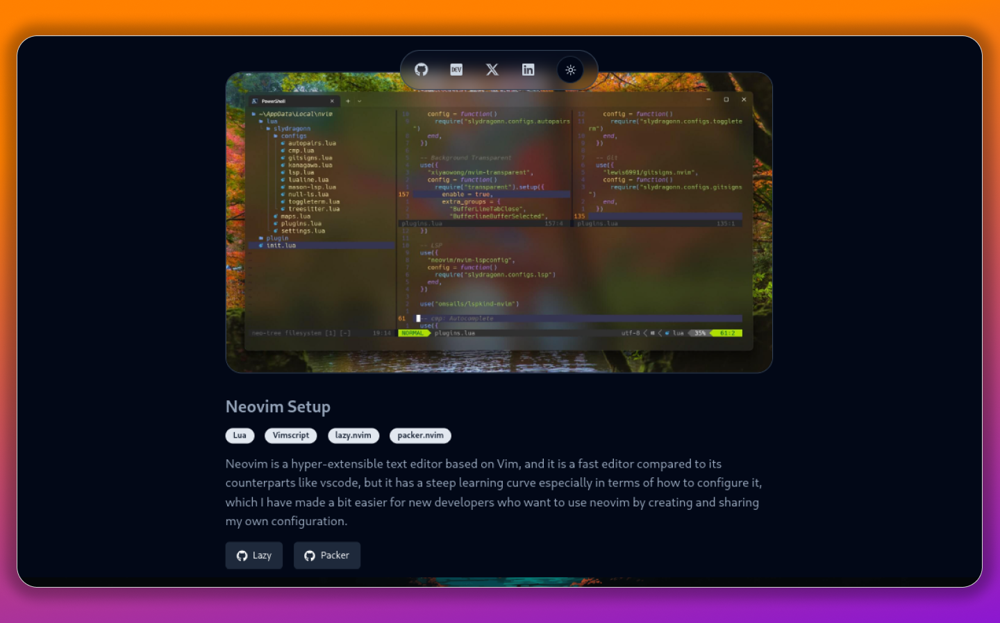

# Gustavo Herrera — Personal Portfolio

[](https://astro.build)
[](https://react.dev)
[](https://tailwindcss.com)
[](LICENSE)

Personal portfolio of **Gustavo Herrera** ([@arcanoix](https://github.com/arcanoix)), **AI Engineer & Senior Fullstack Developer** with 15+ years of experience. Showcasing work in AI agents, RAG, and scalable software platforms through a bilingual, interactive static site.

Built with Astro, React, TypeScript source, and Tailwind CSS.



## Quick start

Use **Node.js 22** (also used by the development Docker image) and npm.

```bash
git clone https://github.com/arcanoix/gustavoherrera.dev.git
cd gustavoherrera.dev
npm ci
npm run dev
```

Open [http://localhost:4321](http://localhost:4321). English is available at `/`; Spanish at `/es/`.

## Features

### Interactive hero

- **Orbital service panel:** Eight service nodes covering AI agents, RAG, SaaS, REST APIs, dashboards, mobile, web, and CFDI. Hovering over the stage pauses the orbit; hover, keyboard focus, or click selects a service and reveals its stack and description.
- **Responsive layout:** The orbital services become a stable, two-column grid on small screens, with a mouse-driven tilt effect on the desktop panel.
- **Rotating roles:** A typewriter cycles through AI Engineer, FullStack, Backend, Frontend, and Mobile Developer roles.
- **Name glitch:** “Gustavo Herrera” briefly distorts into “Arcanoix” on an eight-second cycle. The alias is visible for 1.2 seconds; the accessible name remains Gustavo Herrera.

### Portfolio and visual experience

- **English and Spanish routes:** Shared page components with language-specific navigation, copy, and portfolio data. Role titles remain in English.
- **Project showcase:** Selecting a project displays its screenshot and details on larger screens, with direct project links available on smaller layouts.
- **Skills and experience:** Category-filtered skill cards and a separate professional experience timeline.
- **Posts, about, and contact:** External article links, professional background, and direct contact and social links.
- **Light/dark themes:** Theme switching with localStorage persistence, a theme-aware constellation canvas, violet accents, and glass-style surfaces.
- **Motion preferences:** Reduced-motion handling for the name glitch, typewriter, hero interactions, and background effects. The typewriter falls back to a static AI Engineer label.

The service panel is a visual presentation of capabilities, not a live service-health dashboard. Project previews are screenshots, not embedded applications.

## Development commands

| Command                   | Purpose                                                          |
| ------------------------- | ---------------------------------------------------------------- |
| `npm run dev`             | Start the Astro development server, normally at `localhost:4321` |
| `npm run build`           | Generate the production static site in `dist/`                   |
| `npm run preview`         | Serve the generated production build locally                     |
| `npm run astro -- --help` | Show Astro CLI commands and options                              |
| `npm run prettier`        | **Rewrite** files across the repository with Prettier            |

To check formatting without rewriting files:

```bash
npx prettier README.md --check
```

There is currently no dedicated test or typecheck script. The build command generates the site; it is not a standalone TypeScript typecheck.

### Docker development

With Docker and Docker Compose installed:

```bash
docker compose up --build
```

Open [http://localhost:4321](http://localhost:4321). The development image uses Node 22 Alpine, installs dependencies with `npm ci`, and binds Astro to `0.0.0.0`. Compose mounts the source, keeps container dependencies in a named volume, and enables polling for file changes.

This setup is for local development, not production deployment. To stop it:

```bash
docker compose down
```

## Updating content

Most portfolio content is stored as language-keyed TypeScript data, not Astro Content Collections. Update both language variants when changing content.

| What to update                                              | File                                |
| ----------------------------------------------------------- | ----------------------------------- |
| Shared translated labels, metadata, hero/about/contact copy | `src/i18n/ui.ts`                    |
| Translation lookup and fallback behavior                    | `src/i18n/utils.ts`                 |
| Projects and screenshot references                          | `src/content/projects.ts`           |
| Skill categories and entries                                | `src/content/skills.ts`             |
| Professional experience                                     | `src/content/experiences.ts`        |
| External article entries                                    | `src/content/posts.ts`              |
| Service labels, stacks, and descriptions                    | `src/components/HeroCorePanel.tsx`  |
| Rotating role titles                                        | `src/components/RoleTypewriter.tsx` |
| Name alias, cycle timing, and distortion                    | `src/components/GlitchName.astro`   |
| Shared sections and contact links                           | `src/components/HomeContent.astro`  |
| Global colors, typography, and responsive styles            | `src/styles/globals.css`            |
| Images and other public assets                              | `public/`                           |

Public assets are served from the site root: `public/images/cover.png` is available as `/images/cover.png`.

### Analytics

`src/components/GoogleAnalytics.astro` contains the Google Analytics measurement ID and is included by the shared layout. There is no environment-based or production-only guard, so local browsing can also load analytics. Replace or remove this integration before reusing the site for another portfolio.

## Project structure

```text
├── public/                    # Public images, icons, and media
│   └── images/                # Portfolio cover and project screenshots
├── src/
│   ├── components/            # Shared sections, React islands, and Astro components
│   │   ├── ui/                # Reusable UI primitives
│   │   ├── HomeContent.astro  # Page sections shared by both languages
│   │   ├── HeroCorePanel.tsx  # Interactive orbital service panel
│   │   ├── GlitchName.astro   # CSS-only name/alias animation
│   │   └── RoleTypewriter.tsx # Rotating professional roles
│   ├── content/               # Language-keyed portfolio data
│   ├── i18n/                  # Translated strings and lookup helpers
│   ├── layouts/               # Shared page shell, metadata, and integrations
│   ├── lib/                   # Shared utilities
│   ├── pages/
│   │   ├── index.astro        # English homepage: /
│   │   └── es/index.astro     # Spanish homepage: /es/
│   └── styles/               # Global styles and Tailwind imports
├── astro.config.mjs           # Astro integrations and locale configuration
├── compose.yaml               # Local development container setup
├── Dockerfile.dev             # Node 22 development image
├── package.json               # Dependencies and npm scripts
├── package-lock.json          # Locked dependency tree
└── tailwind.config.mjs        # Tailwind configuration
```

## Stack

- **Rendering:** Astro 5 static generation with hydrated React 19 islands for interactive sections.
- **Source:** Astro components and TypeScript/TSX.
- **Styling:** Tailwind CSS 3.4, global CSS, and component-scoped styles.
- **UI:** Radix UI primitives, Lucide, and React Icons.
- **Tooling:** Prettier with the Astro plugin; Docker Compose for optional local development.

## Author

**Gustavo Herrera / Arcanoix**

- GitHub: [@arcanoix](https://github.com/arcanoix)
- LinkedIn: [in/thavoo](https://www.linkedin.com/in/thavoo/)
- DEV: [dev.to/arcanoix](https://dev.to/arcanoix)
- Freelancer: [freelancer.com/u/gustavoherrera84](https://www.freelancer.com/u/gustavoherrera84)
- X: [@arcanoix\_](https://x.com/arcanoix_)
- WhatsApp: [+58 412-1367894](https://wa.me/584121367894)
- Email: [gustavoh.2312@gmail.com](mailto:gustavoh.2312@gmail.com)

## License

Licensed under the [Apache-2.0 License](LICENSE).
